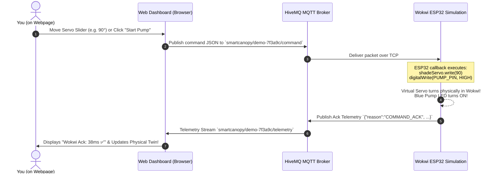

# 🌿 Smart Shadow Canopy OS - Bidirectional Wokwi Remote Control & Dashboard

A real-time IoT Telemetry Dashboard and **Two-Way Remote Controller** that connects directly to your **Wokwi ESP32 Simulation** (or physical ESP32 hardware) via HiveMQ MQTT.

---

## 🕹️ How Webpage &rarr; Wokwi Two-Way Control Works



---

## ⚡ Quick Start: Controlling Wokwi in Real Time

### Step 1: Update Wokwi with the Bidirectional Firmware
1. Open your Wokwi project at [wokwi.com/projects/new/esp32](https://wokwi.com/projects/new/esp32).
2. Copy the updated code from [`esp32-firmware.ino`](file:///C:/Users/om606/.gemini/antigravity-ide/scratch/smart-canopy-dashboard/esp32-firmware.ino) and paste it into Wokwi's `sketch.ino`.
3. In Wokwi, switch to the `diagram.json` tab (or press <kbd>F1</kbd> &rarr; *View diagram.json*), and paste the contents of [`wokwi-diagram.json`](file:///C:/Users/om606/.gemini/antigravity-ide/scratch/smart-canopy-dashboard/wokwi-diagram.json).
4. In Wokwi's Library Manager, ensure the following are installed:
   - `PubSubClient` by Nick O'Leary
   - `DHT sensor library` by Adafruit
   - `ESP32Servo` by Kevin Harrington
5. Click **Start Simulation (Play button)** in Wokwi.
   *In Wokwi's Serial Monitor, you will see:*
   ```
   Connecting to Wokwi WiFi...
   WiFi Connected!
   Connecting to MQTT Broker: broker.hivemq.com
   MQTT Connected!
   Subscribed to Command Topic: smartcanopy/demo-7f3a9c/command
   ```

---

### Step 2: Open Your Web Dashboard
Open [`index.html`](file:///C:/Users/om606/.gemini/antigravity-ide/scratch/smart-canopy-dashboard/index.html) in your browser:
```
file:///C:/Users/om606/.gemini/antigravity-ide/scratch/smart-canopy-dashboard/index.html
```
*(The dashboard connects automatically via WebSockets to `broker.hivemq.com:8884`)*.

---

### Step 3: Command Wokwi from Your Webpage!

Position your browser window next to your Wokwi tab to see both at once:

1. **Control the Canopy Servo in Wokwi**:
   - On the webpage, locate the **"Wokwi Live Remote Command Center"**.
   - Move the **Canopy Awning Servo** slider to **90°** or click **`[🛡️ Deploy (90°)]`**.
   - **Look at Wokwi**: The virtual servo motor arm physically turns to 90° immediately!
   - Click **`[☀️ Open (0°)]`**: The servo motor arm physically turns back to 0°!
   - Click **`[⛱️ Max (180°)]`**: The servo moves all the way to 180°!

2. **Control the Water Pump / LED in Wokwi**:
   - On the webpage, click **`[💧 START WATER PUMP]`**.
   - **Look at Wokwi**: Pin 19 goes `HIGH` and the blue LED / pump turns ON!
   - On the webpage, the physical twin water pump spins and water droplets start dripping!
   - Click **`[⏹️ STOP WATER PUMP]`**: Pin 19 goes `LOW` and the blue LED turns OFF!

3. **Switch Between Modes**:
   - **`[🤖 Autonomous (Sensors)]`**: ESP32 in Wokwi runs its normal automated intelligence (reading LDR, Soil, and DHT22 to trigger shade or water automatically).
   - **`[🕹️ Webpage Manual Override]`**: The webpage takes manual over-the-air command of all actuators!

4. **Push Calibrated Thresholds**:
   - Click **`[⚙️ Push Calibrated Thresholds to Wokwi]`** to update the ESP32's `LIGHT_THRESHOLD`, `SOIL_THRESHOLD`, and `TEMP_THRESHOLD` in memory live over MQTT without restarting Wokwi!

---

## 📡 MQTT Topics & Protocol

| Direction | Topic | Payload Format | Description |
| :--- | :--- | :--- | :--- |
| **Webpage &rarr; Wokwi ESP32** | `smartcanopy/demo-7f3a9c/command` | `{"mode":"MANUAL","servoAngle":90}` | Commands servo angle (0–180°) |
| **Webpage &rarr; Wokwi ESP32** | `smartcanopy/demo-7f3a9c/command` | `{"mode":"MANUAL","pump":"ON"}` | Commands pump ON or OFF |
| **Webpage &rarr; Wokwi ESP32** | `smartcanopy/demo-7f3a9c/command` | `{"mode":"AUTO"}` | Returns control to autonomous sensors |
| **Webpage &rarr; Wokwi ESP32** | `smartcanopy/demo-7f3a9c/command` | `{"lightThresh":2200,"soilThresh":1500,"tempThresh":32.0}` | Updates threshold settings live |
| **Wokwi ESP32 &rarr; Webpage** | `smartcanopy/demo-7f3a9c/telemetry` | `{"light":2500,"soil":1400,"temperature":28.4,"humidity":55.0,"shade":"CLOSED","servoAngle":90,"pump":"ON","mode":"MANUAL","reason":"COMMAND_ACK",...}` | Real-time state & sensor feedback |
